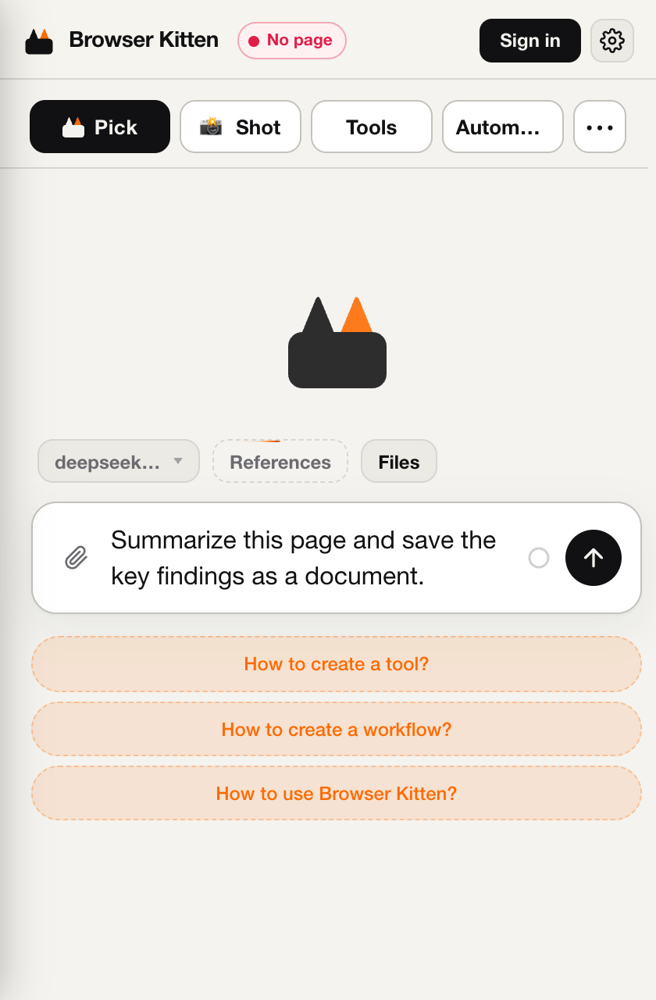
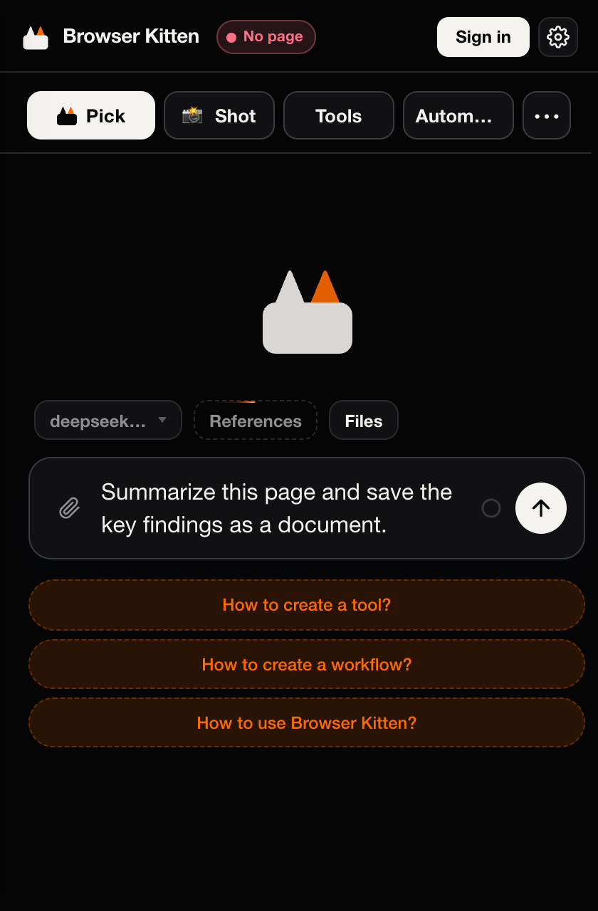

  

<h1 align="center">Browser Kitten</h1>

<strong>An agent for the browser you already use.</strong> Read signed-in pages, take action, create files, and follow up locally.

  
  
  
  

<strong>English</strong> · <a href="README.zh-CN.md">简体中文</a>

<a href="#quick-start">Quick start</a> · <a href="#configuration">Configuration</a> · <a href="docs/README.md">Documentation</a> · <a href="#current-limits">Current limits</a> · <a href="CONTRIBUTING.md">Contribute</a> · <a href="https://github.com/Player-YN/BrowserKitten/issues">Issues</a>

---

Browser Kitten is an MIT-licensed Chrome MV3 extension with an agent in the side panel. It works with your existing browser session and keeps conversations, workspace files, and follow-up tasks on this computer. Model and other provider requests use the services you configure.

**Current source version: 1.2.0 · Load unpacked · No build step for installation.**

## What you can do

| Capability | In practice |
| :--- | :--- |
| **Read & research** | Understand pages you are signed in to, select relevant content, and collect findings. |
| **Act on pages** | Delegate clicks, form entry, and navigation to a separately configured execution model. |
| **Create deliverables** | Save documents, HTML pages, data, and files in a session workspace. |
| **Follow up** | Arrange local checks, preserve progress, and manage ongoing tasks from a collapsible drawer. |

<strong>See the actual side panel — light & dark</strong>

 

  
  

Captured from the extension in a fresh browser profile. The example is an unsent draft, not a completed run.

## Quick start

1. **[Download the current source ZIP](https://github.com/Player-YN/BrowserKitten/archive/refs/heads/main.zip)** and extract it into a folder you will keep.
2. Open `chrome://extensions` in desktop Chrome, enable **Developer mode**, then choose **Load unpacked**. Select `BrowserKitten-main`, the folder that directly contains `manifest.json`.
3. Pin **Browser Kitten**, refresh an ordinary website tab, open the side panel, and configure your providers below.

You do **not** need Node.js, Python, npm, or a build command to install it. The source folder itself is the extension load root.

> **Trying the latest work?** The download above follows `main`. The separate GitHub Releases page may contain older tagged versions.

For the full walkthrough, permissions, update instructions, and troubleshooting, see **[Getting started](docs/GETTING_STARTED.md)** · **[中文安装指南](docs/GETTING_STARTED.zh-CN.md)**.

## Configuration

Open **Settings** from the side-panel menu. For a bring-your-own-key setup:

| Setting | Needed for | Enter |
| :--- | :--- | :--- |
| **Inference** | Planning, analysis, and tool calls | Base URL, API key, and a tool-capable model ID |
| **System1** | Page clicks and form interactions | A separate execution-model configuration using an OpenAI-compatible `/chat/completions` endpoint |
| Image / Transcription / Search | Additional media and web capabilities | Configure only the services you need |

Inference and System1 can use the same provider, but must be configured separately. The unpacked build accepts your own keys without a Browser Kitten subscription; the external providers still charge for usage. Account-hosted services are optional and depend on the separate backend.

Try a small first task:

> Summarize the current page and save its key findings as a document.

**Enter** inserts a newline. **Ctrl+Enter / Cmd+Enter** sends. Enable page scripts and capture permissions only when the task needs them; see the [permission guide](docs/GETTING_STARTED.md#permissions).

## Local follow-ups

Describe the goal, permitted actions, reporting conditions, and when to stop. The agent can arrange or remove wakeups within that goal. Manage them in the **collapsible task drawer above the input**.

- Chrome must remain running and the computer awake. Closing the side panel is fine.
- Checks run on a minute-scale schedule; immediate webpage-event subscriptions are not implemented.
- New scheduled tasks can stay quiet when nothing meaningful changes, and report actions, changes, or requests for help.

See [follow-up behavior and controls](docs/GETTING_STARTED.md#local-follow-ups).

## Current limits

- This is a local browser extension; there is no cloud execution environment or native OS / terminal control.
- The host currently enforces **per-tab leases** and **per-session execution slots**, rather than a global browser lock. Automatic grouping of all agent-controlled website tabs is not implemented. Run one browser-operating task at a time.
- Restricted Chrome pages and the Web Store are not ordinary automation targets. Browser smoke tests do not establish success on every website or with every model.
- Settings and workspaces are local to this Chrome profile. They do not automatically move to another computer. Relevant task content may be sent to your configured providers.

Read [updates and data](docs/GETTING_STARTED.md#updates-and-data) before replacing an installation.

## Documentation

| Start here | Go deeper |
| :--- | :--- |
| [Getting started](docs/GETTING_STARTED.md) · [安装指南](docs/GETTING_STARTED.zh-CN.md) | [Architecture](AGENTS.md) · [Agent runtime](src/agent/AGENTS.md) *(中文)* |
| [Documentation index](docs/README.md) | [Tools & Workflow](docs/PERSONAL_LIBRARY.md) · [Workflow contract](docs/WORKFLOW_V1.md) *(中文)* |
| [Troubleshooting & support](SUPPORT.md) | [UI design](Design.md) · [Media](docs/CHAT_MEDIA_INPUT.md) *(中文)* |
| [Changelog](CHANGELOG.md) | [Security policy](SECURITY.md) · [Third-party notices](THIRD_PARTY_NOTICES.md) |

## Contributing

Bug reports, documentation fixes, and focused pull requests are welcome. Start with **[CONTRIBUTING.md](CONTRIBUTING.md)** for setup and checks. Use a [bug report](https://github.com/Player-YN/BrowserKitten/issues/new?template=bug_report.yml) or [feature request](https://github.com/Player-YN/BrowserKitten/issues/new?template=feature_request.yml) to give maintainers useful context.

Please follow the [Code of Conduct](CODE_OF_CONDUCT.md). Report vulnerabilities through [private security reporting](https://github.com/Player-YN/BrowserKitten/security/advisories/new), rather than a public issue. No response-time commitment is implied.

## License & acknowledgments

[MIT](LICENSE) © 2026 Yiteng (Player-YN). Built with open-source projects including Vercel AI SDK, QuickJS, esbuild, Zod, Lucide, and fflate. See [third-party notices](THIRD_PARTY_NOTICES.md) for their respective licenses.

<a href="#top">Back to top ↑</a>

