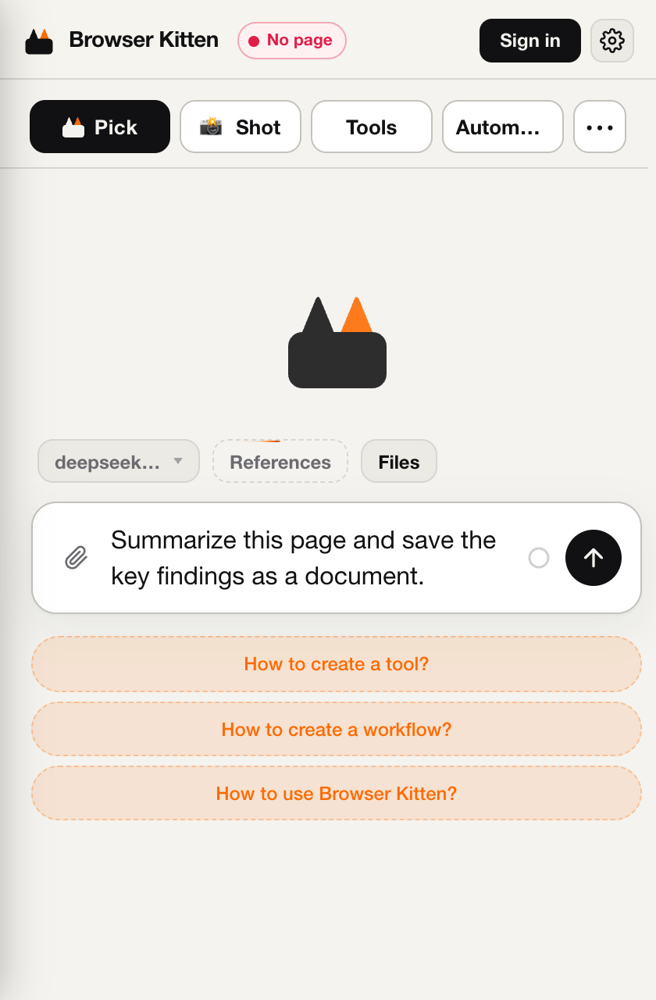
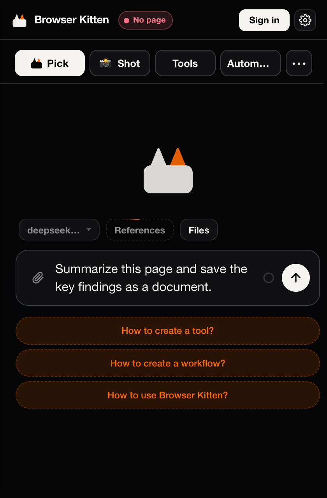

  

<h1 align="center">Browser Kitten</h1>

<strong>在你正在使用的浏览器里，把任务推进到完成。</strong> 读取已登录网页 · 操作页面 · 生成文件 · 本地持续跟进

  
  
  
  

<a href="README.md">English</a> · <strong>简体中文</strong>

<a href="#快速开始">快速开始</a> · <a href="#模型配置">模型配置</a> · <a href="docs/README.md">文档导航</a> · <a href="#当前边界">当前边界</a> · <a href="CONTRIBUTING.md">参与贡献</a> · <a href="https://github.com/Player-YN/BrowserKitten/issues">问题反馈</a>

---

Browser Kitten 是 MIT 开源的 Chrome MV3 扩展，在侧栏中运行通用 Agent。它使用你已有的浏览器登录状态，将会话、工作区文件和持续任务保存在本机；模型及其他服务请求使用你配置的服务商。

**当前源码版本：1.2.0 · 加载已解压的扩展程序 · 安装无需构建。**

## 可以做什么

| 能力 | 具体用途 |
| :--- | :--- |
| **读取** | 理解已登录网页，点选相关内容，收集并整理发现。 |
| **操作** | 通过单独配置的执行模型完成点击、填写和页面导航。 |
| **交付** | 在会话工作区保存文档、HTML 网页、数据和文件。 |
| **跟进** | 安排本地检查、保存进度，在可收起的任务抽屉中管理长任务。 |

<strong>查看真实侧栏界面：浅色与深色</strong>

 

  
  

在独立浏览器配置中截取。截图为英文界面，任务仅为未发送的草稿，并非执行成功演示。

## 快速开始

1. **[下载当前源码 ZIP](https://github.com/Player-YN/BrowserKitten/archive/refs/heads/main.zip)**，解压到一个准备长期保留的位置。
2. 在桌面 Chrome 打开 `chrome://extensions`，开启 **开发者模式**，点击 **加载已解压的扩展程序**，选择直接包含 `manifest.json` 的 `BrowserKitten-main` 文件夹。
3. 固定 **Browser Kitten**，刷新普通网站标签，点击扩展图标打开侧栏，再按下方说明配置模型。

安装**不需要 Node.js、Python、npm 或构建命令**，源码根目录本身就是可加载的扩展。

> **体验最新代码：**上面的下载链接跟随 `main`；GitHub Releases 中的历史标签版本可能更旧。

完整步骤、授权、更新和故障处理见 **[中文安装指南](docs/GETTING_STARTED.zh-CN.md)** · **[English guide](docs/GETTING_STARTED.md)**。

## 模型配置

从侧栏菜单进入 **设置**，使用自己的 API Key 时：

| 设置 | 用途 | 需要填写 |
| :--- | :--- | :--- |
| **推理** | 理解任务、分析和调用工具 | Base URL、API Key、支持工具调用的模型 ID |
| **System1** | 网页点击、填写与控件选择 | 单独配置执行模型，使用 OpenAI-compatible `/chat/completions` 接口 |
| 生图 / 转写 / 搜索 | 额外的媒体与网络能力 | 按任务需要配置 |

推理和 System1 可以使用同一服务商，但要分别配置。unpacked 版本默认允许自带 Key，无需 Browser Kitten 订阅；外部 API 调用仍由对应服务商计费。账户积分服务可选，依赖独立后端。

先试一个小任务：

> 总结当前页面的主要内容，并把关键结论整理成一份文档。

**Enter 换行，Ctrl+Enter / Cmd+Enter 发送。** 页面脚本、录音或录屏按需授权，详见[权限说明](docs/GETTING_STARTED.zh-CN.md#页面脚本与录音--录屏)。

## 本地持续任务

说明目标、允许的操作、报告条件和结束条件，Agent 可在目标内自行安排或移除唤醒。任务位于**输入框上方可收起的任务抽屉**中。

- Chrome 需保持运行，电脑需处于唤醒状态；关闭侧栏后仍可续跑。
- 当前按分钟级间隔检查，尚未实现网页事件即时订阅。
- 新定时任务在没有有意义变化时可以静默更新状态，在有变化、采取行动或需要帮助时报告。

详见[持续任务与控制](docs/GETTING_STARTED.zh-CN.md#持续任务与定时检查)。

## 当前边界

- 当前为本机浏览器扩展，没有云端执行环境，也没有原生 OS 或终端控制。
- 宿主实现的是**按标签页租约**及**按会话执行槽**，尚未实现全浏览器独占及所有 Agent 网页自动入组。体验时请一次运行一个需要操作浏览器的任务。
- Chrome 内部页、Chrome Web Store 等受限页面不能按普通网页操控；浏览器烟测不代表所有网站和模型均已验收。
- 设置与工作区属于当前 Chrome 配置，不会自动跨电脑迁移；执行任务所需内容可能发送给你配置的服务商。

更新前请阅读[更新、数据与能力边界](docs/GETTING_STARTED.zh-CN.md#更新数据与能力边界)。

## 文档导航

| 从这里开始 | 深入了解 |
| :--- | :--- |
| [安装指南](docs/GETTING_STARTED.zh-CN.md) · [English guide](docs/GETTING_STARTED.md) | [架构](AGENTS.md) · [Agent runtime](src/agent/AGENTS.md) |
| [完整文档索引](docs/README.md) | [个人工具](docs/PERSONAL_LIBRARY.md) · [Workflow](docs/WORKFLOW_V1.md) |
| [故障与支持](SUPPORT.md) | [UI 规范](Design.md) · [媒体输入](docs/CHAT_MEDIA_INPUT.md) |
| [变更记录](CHANGELOG.md) | [安全政策](SECURITY.md) · [第三方许可](THIRD_PARTY_NOTICES.md) |

## 参与贡献

欢迎问题报告、文档修正和聚焦的 PR。开发环境、检查方式见 **[CONTRIBUTING.md](CONTRIBUTING.md)**。可通过[缺陷报告](https://github.com/Player-YN/BrowserKitten/issues/new?template=bug_report.yml)或[功能建议](https://github.com/Player-YN/BrowserKitten/issues/new?template=feature_request.yml)提供上下文，使用中文或英文均可。

请遵守[社区行为规范](CODE_OF_CONDUCT.md)。安全漏洞请走[私密报告入口](https://github.com/Player-YN/BrowserKitten/security/advisories/new)，不要公开提交利用细节；项目未承诺固定响应时间。

## 许可证与致谢

[MIT](LICENSE) © 2026 Yiteng (Player-YN)。使用了 Vercel AI SDK、QuickJS、esbuild、Zod、Lucide 和 fflate 等开源项目；各自许可证见[第三方许可说明](THIRD_PARTY_NOTICES.md)。

<a href="#top">返回顶部 ↑</a>

